  

 

 

<!-- ───────────── 01 · ABOUT ───────────── -->

 

<!-- ───────────── 02 · TECH STACK ───────────── -->

<table align="center" width="100%">
  <tr>
    <td align="center" width="50%">
      <h4>🎨 Frontend</h4>
      
    </td>
    <td align="center" width="50%">
      <h4>⚙️ Backend &amp; Database</h4>
      
    </td>
  </tr>
  <tr>
    <td align="center" width="50%">
      <h4>🧰 Tools &amp; Workflow</h4>
      
    </td>
    <td align="center" width="50%">
      <h4>🤖 AI Toolkit</h4>
      
      
      
      
      
      
    </td>
  </tr>
</table>

 

<!-- ───────────── 03 · 3D CONTRIBUTIONS ───────────── -->

<!-- Generated by .github/workflows/profile.yml (run it once from the Actions tab) -->

 

<!-- ───────────── 04 · ANALYTICS ───────────── -->

 

<!-- ───────────── 05 · PROJECTS ───────────── -->

  

<picture>
  <source media="(prefers-color-scheme: dark)" srcset="https://raw.githubusercontent.com/AVII-YADAV/AVII-YADAV/output/github-snake-dark.svg" />
  <source media="(prefers-color-scheme: light)" srcset="https://raw.githubusercontent.com/AVII-YADAV/AVII-YADAV/output/github-snake.svg" />
  
</picture>

 

<!-- ───────────── CONNECT ───────────── -->

 

⭐ Like my work? Star a repo and follow along.

